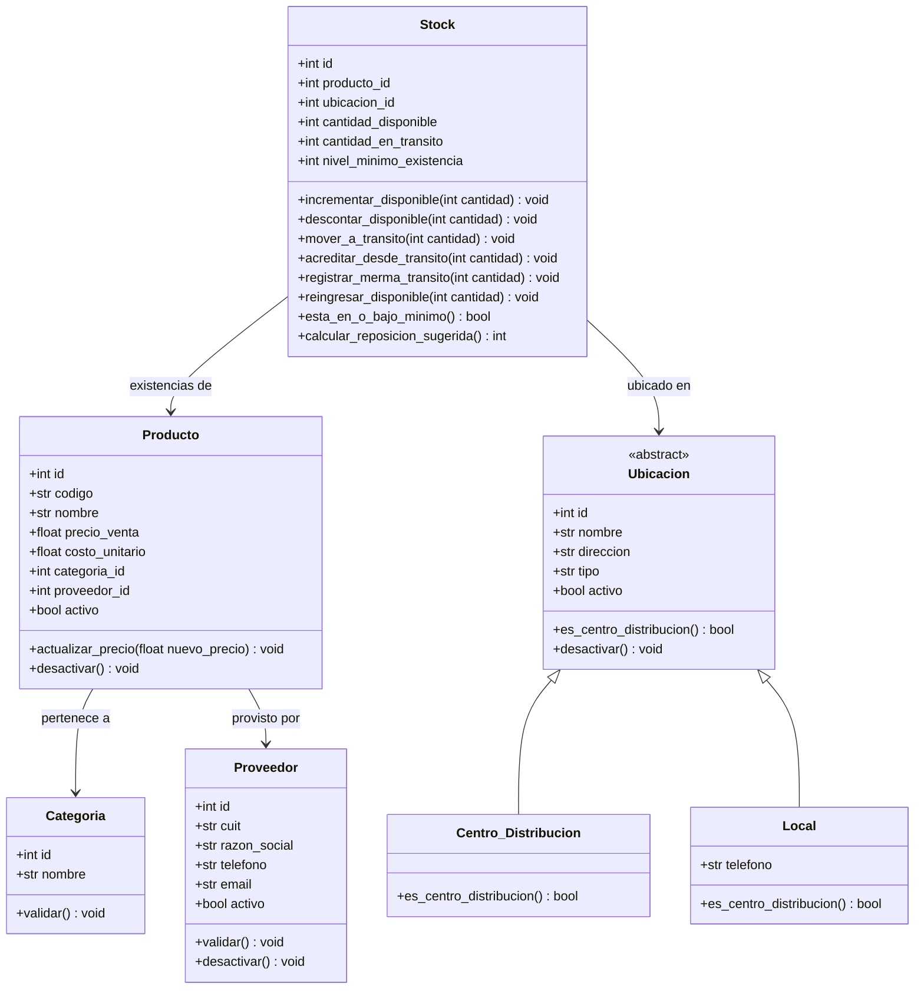
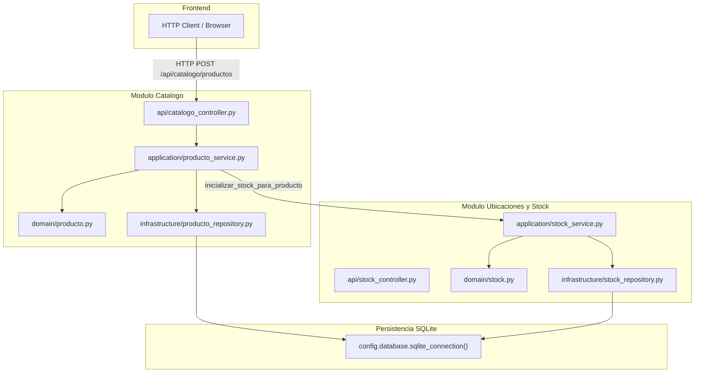
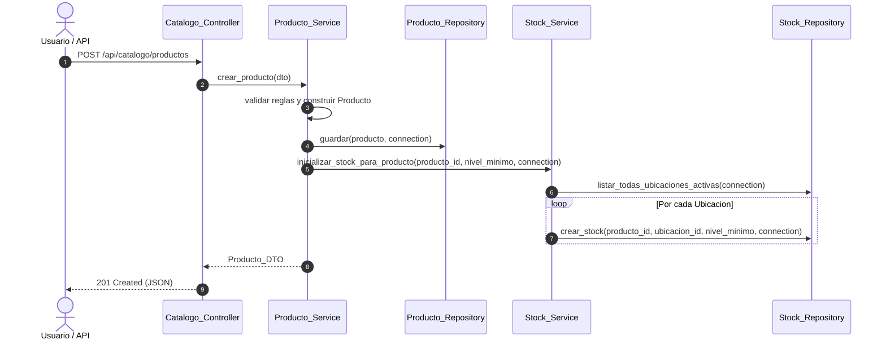
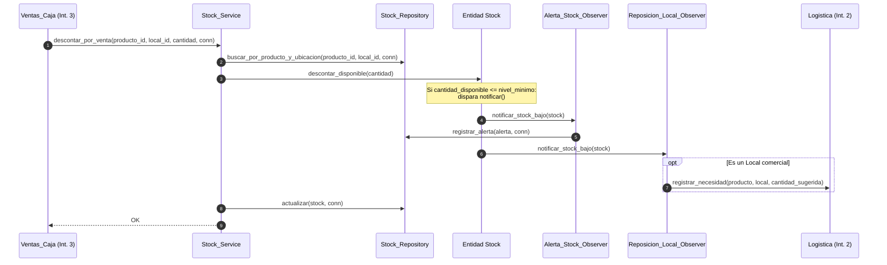

# Especificación de Implementación - Integrante 1: Catálogo, Ubicaciones e Inventario

> **Módulos asignados:** `catalogo`, `ubicaciones_stock`  
> **Referencia:** `docs/implementacion.md` (Sección 3: Integrante 1, Sección 4: Contratos), `docs/convenciones.md` y [migracion_orm_sqlalchemy.md](migracion_orm_sqlalchemy.md).
> **Estrategia de Desarrollo:** **Core First** (Catálogo y Stock funcional) y posterior integración del patrón **Observer**.

---

## 1. Objetivo y Fuera de Alcance

### Objetivo
Construir el núcleo operativo base del ERP:
1. Maestro de catálogo (`Producto`, `Categoria`, `Proveedor`).
2. Maestro de ubicaciones físicas (`Ubicacion`, `Local`, `Centro_Distribucion`).
3. Gestión de inventario por ubicación (`Stock`), garantizando el ingreso exclusivo de compras al Centro de Distribución (CD).
4. Publicación del contrato de servicios de stock (`Stock_Service`) para consumo de Logística (Int. 2) y Ventas (Int. 3).
5. Implementación posterior del patrón de diseño **Observer** para desacoplar el monitoreo de niveles mínimos de stock y la generación de alertas y requerimientos de reposición.

### Fuera de Alcance
- **Logística y despacho:** Consolidación de órdenes de reposición, armado de remitos, bultos y precintos (Integrante 2 - `logistica`).
- **Punto de venta y caja:** Facturación, cobros con medios de pago dinámicos y devoluciones (Integrante 3 - `ventas_caja`).
- **Reportes analíticos consolidados:** Consultas no triviales de márgenes y ventas (Integrante 4 - `reportes`).
- **Ingreso directo de compras a locales:** Físicamente prohibido en el dominio; solo el CD recibe mercadería externa.

---

## 2. Modelo de Datos Detallado (Data Model)

### 2.1 Diagrama de Clases del Dominio



### 2.2 Esquema relacional SQLite (transición a ORM)

> El DDL heredado deja de ser la fuente operativa. Las entidades SQLAlchemy ORM y
> `Base.metadata.create_all()` son la fuente de verdad conforme al spec transversal
> [`migracion_orm_sqlalchemy.md`](migracion_orm_sqlalchemy.md). Hasta completar la
> fase del módulo, los repositories heredados pueden usar el adaptador temporal
> `config.database.legacy_sqlite`; no se agrega persistencia nueva sobre él.

```sql
-- Habilitar integridad referencial en cada sesion
PRAGMA foreign_keys = ON;

-- 1. Categorias
CREATE TABLE IF NOT EXISTS categorias (
    id INTEGER PRIMARY KEY AUTOINCREMENT,
    nombre TEXT NOT NULL UNIQUE
);

-- 2. Proveedores
CREATE TABLE IF NOT EXISTS proveedores (
    id INTEGER PRIMARY KEY AUTOINCREMENT,
    cuit TEXT NOT NULL UNIQUE CHECK (length(cuit) = 11 AND cuit GLOB '[0-9]*'),
    razon_social TEXT NOT NULL,
    telefono TEXT NOT NULL,
    email TEXT NOT NULL,
    activo INTEGER NOT NULL DEFAULT 1 CHECK (activo IN (0, 1))
);

-- 3. Ubicaciones
CREATE TABLE IF NOT EXISTS ubicaciones (
    id INTEGER PRIMARY KEY AUTOINCREMENT,
    tipo TEXT NOT NULL CHECK (tipo IN ('CD', 'LOCAL')),
    nombre TEXT NOT NULL,
    direccion TEXT NOT NULL,
    telefono TEXT,
    activo INTEGER NOT NULL DEFAULT 1 CHECK (activo IN (0, 1))
);

-- 4. Productos
CREATE TABLE IF NOT EXISTS productos (
    id INTEGER PRIMARY KEY AUTOINCREMENT,
    codigo TEXT NOT NULL UNIQUE,
    nombre TEXT NOT NULL,
    precio_venta REAL NOT NULL CHECK (precio_venta > 0),
    costo_unitario REAL NOT NULL CHECK (costo_unitario > 0),
    categoria_id INTEGER NOT NULL REFERENCES categorias(id),
    proveedor_id INTEGER NOT NULL REFERENCES proveedores(id),
    activo INTEGER NOT NULL DEFAULT 1 CHECK (activo IN (0, 1))
);

-- 5. Stocks (Un registro unico por par producto - ubicacion)
CREATE TABLE IF NOT EXISTS stocks (
    id INTEGER PRIMARY KEY AUTOINCREMENT,
    producto_id INTEGER NOT NULL REFERENCES productos(id),
    ubicacion_id INTEGER NOT NULL REFERENCES ubicaciones(id),
    cantidad_disponible INTEGER NOT NULL DEFAULT 0 CHECK (cantidad_disponible >= 0),
    cantidad_en_transito INTEGER NOT NULL DEFAULT 0 CHECK (cantidad_en_transito >= 0),
    nivel_minimo_existencia INTEGER NOT NULL DEFAULT 1 CHECK (nivel_minimo_existencia > 0),
    CONSTRAINT uq_stock_producto_ubicacion UNIQUE (producto_id, ubicacion_id)
);

-- 6. Alertas de Stock (Generadas por el Observer)
CREATE TABLE IF NOT EXISTS alertas_stock (
    id INTEGER PRIMARY KEY AUTOINCREMENT,
    stock_id INTEGER NOT NULL REFERENCES stocks(id),
    producto_id INTEGER NOT NULL REFERENCES productos(id),
    ubicacion_id INTEGER NOT NULL REFERENCES ubicaciones(id),
    cantidad_disponible INTEGER NOT NULL,
    nivel_minimo INTEGER NOT NULL,
    fecha_emision TEXT NOT NULL,
    leida INTEGER NOT NULL DEFAULT 0 CHECK (leida IN (0, 1))
);
```

### 2.3 Objetos de Transferencia de Datos (DTOs)

#### Módulo `catalogo`:
- `Categoria_DTO(id: int | None, nombre: str)`
- `Proveedor_DTO(id: int | None, cuit: str, razon_social: str, telefono: str, email: str, activo: bool)`
- `Producto_DTO(id: int | None, codigo: str, nombre: str, precio_venta: float, costo_unitario: float, categoria_id: int, proveedor_id: int, nivel_minimo: int, activo: bool)`

#### Módulo `ubicaciones_stock`:
- `Ubicacion_DTO(id: int | None, tipo: str, nombre: str, direccion: str, telefono: str | None, activo: bool)`
- `Stock_DTO(id: int, producto_id: int, ubicacion_id: int, cantidad_disponible: int, cantidad_en_transito: int, nivel_minimo_existencia: int)`
- `Ingreso_Mercaderia_DTO(producto_id: int, cd_id: int, cantidad: int, comprobante: str | None)`
- `Alerta_Stock_DTO(id: int, stock_id: int, producto_id: int, ubicacion_id: int, cantidad_disponible: int, nivel_minimo: int, fecha_emision: str, leida: bool)`

---

## 3. Comunicación entre Clases y Arquitectura de Capas

### 3.1 Flujo General de Capas
El sistema sigue de forma estricta la arquitectura monolítica modular:
`api → application → domain` con `infrastructure` implementando la persistencia de interfaces de repositorio.



### 3.2 Flujo 1: Creación de Producto e Inicialización de Stock (Core)
Al crear un producto, este debe quedar disponible en el catálogo y con stock en cero en cada ubicación física del sistema.



### 3.3 Flujo 2: Descuento por Venta y Disparo del Observer (Fase Observer)
Demuestra el desacoplamiento: `Stock` no conoce a la API ni a bases de datos; solo dispara la notificación a sus observadores registrados cuando perfora el stock mínimo.



---

## 4. Estrategia de Implementación: Core First y luego Observer

Para garantizar la estabilidad y la no duplicación de esfuerzos, la construcción se divide en 3 etapas secuenciales:

### Etapa 1: Core de `catalogo`
- Entidades de dominio puras (`Producto`, `Categoria`, `Proveedor`) con validaciones de atributos.
- Excepciones tipadas (`Entidad_Duplicada_Exception`, `Datos_Invalidos_Exception`, `Entidad_No_Encontrada_Exception`).
- Repositorios SQLite para persistencia y mapeo DTO.
- Servicios de aplicación (`Producto_Service`, `Proveedor_Service`, `Categoria_Service`).
- Endpoints HTTP y pruebas unitarias de dominio e integración con SQLite en memoria.

### Etapa 2: Core de `ubicaciones_stock`
- Entidades de dominio `Ubicacion` (`Centro_Distribucion`, `Local`) y `Stock` con sus operaciones aritméticas e invariantes (sin Observer aún).
- Validación estricta: Ingreso de compras **exclusivo** en CD (`ingresar_mercaderia_cd`).
- Contratos públicos de `Stock_Service`:
  - `reservar_para_despacho`
  - `registrar_en_transito`
  - `acreditar_verificado`
  - `registrar_merma`
  - `consultar_disponible`
  - `descontar_por_venta`
  - `reingresar_por_devolucion`
- Inicialización masiva de `Stock` al dar de alta producto.
- Repositorios SQLite, endpoints HTTP y pruebas de todos los contratos.

### Etapa 3: Patrón Observer
- Definición de la interfaz `Stock_Observer` en el dominio de `ubicaciones_stock`.
- `Stock` hereda/incorpora métodos `agregar_observador(obs)` y `notificar()`.
- Implementación de observadores:
  1. `Alerta_Stock_Observer`: Persiste la alerta en la base de datos.
  2. `Reposicion_Local_Observer`: Valida si es sucursal local y calcula `(minimo * 2) - disponible`, llamando al servicio de reposición (o stub/interfaz de Integrante 2).
- Configuración en la capa de aplicación (`Stock_Service`) para suscribir los observadores correspondientes al cargar o instanciar la entidad.
- Pruebas unitarias de Observer sin base de datos y pruebas de integración con persistencia.

---

## 5. Plan Detallado de Tareas (Task Breakdown)

### Fase 1: Core de Catálogo (`catalogo`)
- [x] **T1.1 (Dominio):** Implementar entidades `Categoria`, `Proveedor` y `Producto` en `backend/src/modules/catalogo/domain/` con properties, validaciones de código, precio > 0, costo > 0 y CUIT 11 dígitos.
- [x] **T1.2 (Excepciones):** Verificar y complementar `catalogo_exceptions.py` con `Entidad_Duplicada_Exception`, `Datos_Invalidos_Exception`, `Entidad_No_Encontrada_Exception`.
- [x] **T1.3 (DTOs y Mappers):** Crear DTOs de entrada/salida y funciones de mapeo `entidad ↔ DTO` y `row ↔ entidad`.
- [x] **T1.4 (Infraestructura SQLite):** Implementar `Categoria_Repository`, `Proveedor_Repository` y `Producto_Repository` con sentencias SQL parametrizadas (`?`).
- [x] **T1.5 (Servicios de Aplicación):** Implementar `Categoria_Service`, `Proveedor_Service` y `Producto_Service`.
- [x] **T1.6 (API HTTP):** Implementar endpoints REST en `catalogo/api/` con manejo y traducción de códigos de error HTTP (200, 201, 204, 400, 404, 409).
- [x] **T1.7 (Tests):** Pruebas unitarias de dominio y pruebas de repositorio/servicio con SQLite `:memory:`.

### Fase 2: Core de Ubicaciones e Inventario (`ubicaciones_stock`)
- [x] **T2.1 (Dominio):** Implementar jerarquía de `Ubicacion` (`Local`, `Centro_Distribucion`) y la entidad `Stock` con sus métodos mutadores de inventario (`backend/src/modules/ubicaciones_stock/domain/`).
- [x] **T2.2 (Excepciones):** Completar `stock_exceptions.py` con `Stock_Insuficiente_Exception`, `Ubicacion_Con_Stock_Exception`, `Entidad_No_Encontrada_Exception`.
- [x] **T2.3 (DTOs y Mappers):** Implementar DTOs para ubicaciones, stock e ingreso de mercadería.
- [x] **T2.4 (Infraestructura SQLite):** Crear `Ubicacion_Repository` y `Stock_Repository` soportando transacciones mediante `connection` inyectada.
- [x] **T2.5 (Servicio Stock y Contratos):** Implementar `Ubicacion_Service` y `Stock_Service` con todos los contratos de la Sección 4 de la consigna (`reservar_para_despacho`, `registrar_en_transito`, `acreditar_verificado`, `registrar_merma`, `consultar_disponible`, `descontar_por_venta`, `reingresar_por_devolucion`, `ingresar_mercaderia_cd`).
- [x] **T2.6 (Integración Catálogo - Stock):** Enlazar `Producto_Service` para invocar `Stock_Service.inicializar_stock_para_producto` dentro de la misma transacción.
- [x] **T2.7 (API HTTP):** Endpoints REST para sucursales, CD, ingresos al CD y consultas de stock.
- [x] **T2.8 (Tests):** Pruebas de integración de todos los contratos de stock y validación de ingreso exclusivo a CD.

### Fase 3: Patrón Observer
- [x] **T3.1 (Contrato Observer en Dominio):** Definir protocolo o clase abstracta `Stock_Observer` en `ubicaciones_stock/domain/observers.py`.
- [x] **T3.2 (Emisión en Stock):** Añadir suscripción y disparo de observadores en `Stock.descontar_disponible()` cuando `cantidad_disponible <= nivel_minimo_existencia`.
- [x] **T3.3 (Observador de Alertas):** Implementar `Alerta_Stock_Observer` y tabla `alertas_stock` para persistir notificaciones de stock crítico.
- [x] **T3.4 (Observador de Reposición):** Implementar `Reposicion_Local_Observer` que calcule `(minimo * 2) - disponible` y registre la necesidad solo si es un local y no tiene una necesidad previa pendiente.
- [x] **T3.5 (API y Tests Observer):** Endpoint `GET /api/stock/alertas` y pruebas unitarias completas del patrón Observer.

### Fase 4: Cierre, DDL Central y Verificaciones
- [~] **T4.1 (Modelos ORM y seed):** Modelos ORM hechos; el seed de datos de demo queda pendiente. Declarar las tablas de Catálogo, Ubicaciones y Stock en entidades ORM y crear un seed idempotente cuando se integre su fase.
- [x] **T4.2 (Scripts de Integridad):** Ejecutar `.agents/scripts/check_structure.py` y `.agents/scripts/check_conventions.py`.
- [x] **T4.3 (Suite de Pruebas):** Ejecutar `pytest` sobre toda la suite de pruebas creadas.

---

## 6. Notas de implementación

- **ORM como única fuente del esquema.** `catalogo/infrastructure/models.py` y `ubicaciones_stock/infrastructure/models.py` declaran `categorias`, `proveedores`, `productos`, `ubicaciones`, `stocks` y `alertas_stock` con los mismos nombres de columnas, más sus `UNIQUE`, `CHECK` y FK. Se retiraron `config/schema.sql` y `legacy_schema_initializer.py`.
- **Dependencias entre módulos.** Solo se importa `application/` de otro módulo:
  - Catálogo crea el stock del producto nuevo mediante el puerto `Inicializador_Stock_Contract`, que implementa `Stock_Service`.
  - Stock consulta productos con `Catalogo_Consulta_Service`.
  - Ventas y logística delegan en `Stock_Service` y `Ubicacion_Service` a través de sus adaptadores.
- **Observer.** `Stock` es el sujeto: notifica cuando el disponible baja y queda en o bajo el mínimo, y también cuando se sube el mínimo por encima del disponible.
  - `Alerta_Stock_Observer` guarda una alerta y no la repite mientras haya una sin leer.
  - `Reposicion_Local_Observer` pide reposición solo para locales, con la cantidad `mínimo * 2 - disponible`, mediante el puerto `Registro_Necesidad_Contract`. Logística implementa ese puerto con `Registro_Necesidad_Desde_Stock`, y `bootstrap/application_factory.py` lo suscribe como composition root.
- **Concurrencia.** `Stock_Repository.obtener_para_actualizar` toma el lock de escritura de SQLite antes de leer. Así, dos ventas o reservas simultáneas no venden la misma unidad (V3).
- **Reglas del equipo.**
  - Un único CD, garantizado también por un índice único parcial; el CD no se puede dar de baja.
  - La mercadería del proveedor solo ingresa al CD.
  - Las ubicaciones y los productos se dan de baja lógica. Un producto inactivo no se vende ni entra en órdenes nuevas, pero lo que ya está en tránsito se puede recibir.
