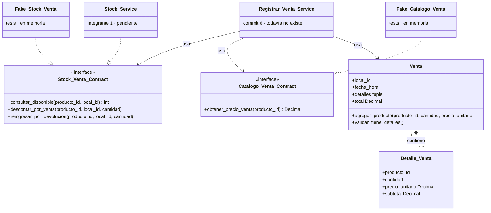

# Ventas: commits 1 y 2 explicados

> Material de estudio del Integrante 3. Explica qué hace cada archivo de los dos primeros commits de `feature/ventas-caja` y por qué está hecho así.

---

## 1. Dónde estás

Estás en la rama `feature/ventas-caja`. El commit 1 ya está hecho. El commit 2 está escrito y probado, pero **todavía no está commiteado**: lo hacés vos cuando lo entiendas.

| Commit | Mensaje | Estado |
|---|---|---|
| 1 | `feat(ventas_caja): agrega puertos de stock y catálogo para ventas` | Hecho (`4ba7ade`) |
| 2 | `feat(ventas_caja): agrega dominio de Venta y Detalle_Venta` | Archivos listos, sin commitear |

Con `git status` ves lo que falta commitear: `venta.py`, `detalle_venta.py`, dos archivos de excepciones y `test_venta.py`.

Los dos commits son **solo Python puro**: no tocan la base de datos, la API ni FastAPI, y por eso sus tests corren sin instalar nada. Es a propósito: las reglas de negocio se escriben y se prueban primero, sin depender de la infraestructura.

---

## 2. Cómo encajan las piezas



El servicio de ventas (commit 6) va a usar los dos contratos y la `Venta`, pero nunca el `Stock_Service` real. Ese servicio, igual que los fakes de los tests, solo **implementa** el contrato. Por eso las flechas punteadas apuntan hacia el contrato.

---

## 3. Commit 1: puertos de stock y catálogo

Ventas define **qué necesita** de stock y de catálogo sin depender de **cómo** lo implemente el Integrante 1. Eso se llama un *puerto*, y aplica el principio de Inversión de Dependencias (la D de SOLID).

### 3.1 El problema

Para vender necesitás dos cosas que no son tuyas:

- Saber cuánto stock hay en el local, descontarlo y reingresarlo en una devolución. Lo resuelve el Integrante 1, en `ubicaciones_stock`.
- Saber el precio de venta de un producto. También es del Integrante 1, en `catalogo`.

Si tu código importara directamente el `Stock_Service` del Integrante 1:

1. **Quedarías bloqueado:** ese servicio todavía no existe, así que no podrías programar ni testear.
2. **Quedarías acoplado:** si el Integrante 1 cambia cómo guarda el stock, tu código se rompe.

### 3.2 La solución: invertir la dependencia

En lugar de que ventas dependa del servicio de stock, **ventas publica una interfaz** que dice "esto es lo que necesito", y el servicio de stock se compromete a cumplirla.

```text
Sin puerto:   ventas  ──depende de──▶  Stock_Service (concreto)
Con puerto:   ventas  ──depende de──▶  Stock_Venta_Contract (abstracto)  ◀──implementa──  Stock_Service
```

Ahora la flecha de dependencia apunta a la abstracción, que es tuya. Por eso se llama *inversión*.

Una analogía de construcción: vos diseñás el tomacorriente (la interfaz) y el electricista conecta los cables por detrás. Mientras tanto, probás tus aparatos con un generador portátil (el *fake*).

### 3.3 Archivo: `stock_venta_contract.py`

Ruta: `backend/src/modules/ventas_caja/application/stock_venta_contract.py`

```python
class Stock_Venta_Contract(ABC):
    @abstractmethod
    def consultar_disponible(self, producto_id: int, local_id: int) -> int: ...

    @abstractmethod
    def descontar_por_venta(self, producto_id: int, local_id: int, cantidad: int) -> None: ...

    @abstractmethod
    def reingresar_por_devolucion(self, producto_id: int, local_id: int, cantidad: int) -> None: ...
```

| Pieza | Qué significa |
|---|---|
| `ABC` | *Abstract Base Class*. No se puede instanciar: `Stock_Venta_Contract()` lanza `TypeError`. Solo sirve para heredar. |
| `@abstractmethod` | Obliga a cada clase hija a implementar el método. Si falta uno, Python no deja crear el objeto. |
| `consultar_disponible` | Se usa antes de vender, para validar **todas** las líneas antes de descontar nada (regla V3 de la consigna). |
| `descontar_por_venta` | Resta stock cuando se confirma la venta. Puede disparar el Observer del Integrante 1 si el stock queda bajo el mínimo. |
| `reingresar_por_devolucion` | Suma stock cuando se acepta una devolución. |
| Ids `int` | Las tablas `stocks` y `productos` del Integrante 1 usan enteros. Logística usa `str`, y eso hay que acordarlo en el grupo. |

**Por qué está en `application/` y no en `domain/`:** describe cómo el caso de uso se comunica con otro módulo. El dominio (`Venta`) no conoce el stock; lo usa el servicio de aplicación (commit 6).

### 3.4 Archivo: `catalogo_venta_contract.py`

Mismo concepto, con un solo método: `obtener_precio_venta(producto_id) -> Decimal`.

El precio sale del catálogo y **nunca del cliente**. Si el precio viniera en el request HTTP, cualquiera podría comprar a $1. Devuelve `Decimal` porque la regla del equipo (`python-rules.md`) prohíbe usar `float` para dinero.

### 3.5 Archivo: `tests/ventas_caja/fakes.py`

Son implementaciones **en memoria** de los dos contratos, para los tests:

- `Fake_Stock_Venta` guarda el stock en un diccionario `{(producto_id, local_id): cantidad}`. Descuenta, reingresa y lanza `Stock_Insuficiente_Exception` si no alcanza. Además registra cada operación en `operaciones`, para que los tests puedan comprobar que **no** se descontó nada cuando una venta falla.
- `Fake_Catalogo_Venta` guarda los precios en un diccionario y lanza `Entidad_No_Encontrada_Exception` si el producto no existe.

**Fake vs. mock:**

| | Mock | Fake |
|---|---|---|
| Qué hace | Solo registra que lo llamaron | Funciona de verdad, pero en memoria |
| Ejemplo en el repo | `Mock_Stock_Service` de logística | `Fake_Stock_Venta` |
| ¿Valida reglas? | No: descontar 1000 unidades "funciona" | Sí: si no alcanza, lanza la excepción |
| Qué te asegura | Que llamaste al método | Que tu lógica se porta bien con un stock real |

**Por qué el fake lanza excepciones de `ubicaciones_stock` y `catalogo`, y no las de ventas:** el `Stock_Service` real va a lanzar **su propia** `Stock_Insuficiente_Exception`. El `except` atrapa por clase, y dos clases con el mismo nombre en módulos distintos son clases distintas. Si tu código esperara la de ventas, nunca la atraparía. Por eso la `Stock_Insuficiente_Exception` duplicada en `ventas_exceptions.py` es un tema a resolver con el grupo.

**Por qué el fake vive en `tests/` y no en `src/`:** es código de prueba. La auditoría encontró que logística tiene su mock en `src/` y lo usa en producción sin darse cuenta.

### 3.6 Archivo: `tests/ventas_caja/__init__.py`

Está vacío, pero sin él `python -m unittest` no reconoce la carpeta como paquete y no corre tus tests. Eso les pasó a los 25 tests de logística.

---

## 4. Commit 2: dominio de Venta y Detalle_Venta

Una `Venta` siempre hace cumplir sus reglas: el total no puede quedar mal, nadie puede agregar una línea inválida y nadie puede tocar las líneas desde afuera. Esas reglas que se cumplen siempre se llaman **invariantes**, y proteger las invariantes es el trabajo de una entidad.

### 4.1 El concepto: invariantes y encapsulamiento

Una clase con atributos públicos y setters para todo es una bolsa de datos: cualquiera puede dejarla en un estado imposible (`venta.total = 5` con líneas que suman 1000). Una **entidad** decide qué se puede cambiar y por qué camino:

- Los atributos son privados (`self._total`, con guion bajo) y se exponen con `@property`, que es de solo lectura si no tiene setter.
- Los cambios entran por métodos con nombre de negocio (`agregar_producto`), que validan antes de modificar.
- Lo que se puede calcular, se calcula: no se guarda una copia que pueda desincronizarse.

### 4.2 Archivo: `ventas_exceptions.py` (modificado)

Se agregó `Venta_Invalida_Exception(BusinessError)`, para cuando los datos de la venta o de una línea no cumplen las reglas. Hacía falta porque el equipo no tenía una excepción de "datos inválidos" para ventas, y la auditoría marcó como problema que logística lance `BusinessError` genérico. También se agregó al `__init__.py` de excepciones, para poder importarla desde `modules.ventas_caja.domain.exceptions`.

Como hereda de `BusinessError`, el handler global de la API la convierte en HTTP 400 sin código extra.

### 4.3 Archivo: `detalle_venta.py`

Una línea de venta: qué producto, cuántas unidades y a qué precio.

| Código | Qué hace y por qué |
|---|---|
| `__init__(producto_id, cantidad, precio_unitario)` | Valida todo **antes** de guardar. Si algo falla, el objeto nunca llega a existir: no hay "línea inválida a medio crear". |
| `_es_entero_positivo(...)` | Acepta solo un `int` mayor a 0. Excluye `bool` a propósito: en Python `True` es un `int` que vale 1, así que sin ese chequeo `cantidad=True` pasaría. |
| `isinstance(precio_unitario, Decimal)` | Rechaza `float`. Probá en Python `0.1 + 0.2`: da `0.30000000000000004`. Con dinero, ese error de redondeo se acumula. |
| Solo `@property`, sin setters | La línea es **inmutable**: una vez creada, no cambia. |
| `subtotal` | Se calcula como `precio_unitario * cantidad`. No se guarda. |
| `precio_unitario` | Es el precio **al momento de vender**. Si mañana el catálogo sube el precio, esta venta mantiene el anterior. Eso permite que los reportes y las devoluciones sean correctos. |

### 4.4 Archivo: `venta.py`

La venta de uno o más productos en un local.

| Elemento | Qué hace y por qué |
|---|---|
| `__init__(local_id, fecha_hora, id=None)` | Valida el local (entero positivo) y la fecha (`datetime`). Empieza sin líneas. |
| `id` con setter protegido | El id lo asigna la base de datos al guardar (commit 5), por eso empieza en `None`. El setter permite asignarlo **una sola vez**: cambiar el id de una venta ya guardada rompería las referencias. Es el mismo patrón que `Bulto` en logística. |
| `detalles` devuelve una `tuple` | La lista interna `_detalles` nunca sale de la clase. Hacia afuera se entrega una tupla, que no tiene `.append()`. La única forma de agregar líneas es `agregar_producto()`. |
| `total` sin setter | Se calcula sumando los subtotales: `sum(..., Decimal("0"))`. El `Decimal("0")` inicial es necesario porque `sum` arranca en el entero `0`, y con una venta vacía devolvería `0` en lugar de un `Decimal`. |
| `agregar_producto(producto_id, cantidad, precio)` | Primero crea el `Detalle_Venta` nuevo, así que si los datos son inválidos falla **antes** de tocar la venta. Si el producto no estaba, agrega la línea. Si ya estaba, lo unifica (ver abajo). |
| `validar_tiene_detalles()` | Lanza error si la venta no tiene líneas. Todavía no se llama: se usa al confirmar (commit 4). Mientras se carga, una venta vacía es un estado válido. |
| `_buscar_detalle(producto_id)` | Método privado (guion bajo): es un detalle interno, no forma parte de la interfaz. |

**Cómo funciona la unificación de líneas:** si se agrega dos veces el producto 1 (2 unidades y después 3), no quedan dos líneas, sino una de 5. Como `Detalle_Venta` es inmutable, no se le suma la cantidad: se **reemplaza** la línea vieja por una nueva con la cantidad total. Si el mismo producto llega con **otro precio**, se rechaza con `Venta_Invalida_Exception`, porque en una venta un producto tiene un único precio.

**Qué NO hace la venta (y está bien):** no consulta el stock, no conoce la base de datos y no cobra. Sabe sumar, validar y protegerse. El stock lo valida el servicio (commit 6), el cobro lo hace la Strategy (commit 3) y la persistencia el repositorio (commit 5). Cada clase tiene una sola razón para cambiar: es el principio de Responsabilidad Única (la S de SOLID).

---

## 5. Los tests

Los dos commits suman 26 tests, y todos pasan. Cada test prueba una regla y su nombre dice cuál, así que leer la lista de nombres es leer las reglas de negocio.

### 5.1 Cómo correrlos

Desde `backend/`:

```bash
python -m unittest tests.ventas_caja.test_contratos_venta tests.ventas_caja.test_venta -v
```

`-v` muestra el nombre de cada test. No hace falta instalar nada: estos tests usan solo la biblioteca estándar de Python.

Cada archivo empieza con `sys.path.insert(0, .../src)`. Esa línea le indica a Python dónde buscar `modules`, porque el código está en `backend/src` y los tests en `backend/tests`. Es el mismo patrón que usan los tests de logística.

### 5.2 Commit 1: `test_contratos_venta.py` (10 tests)

| Test | Qué asegura |
|---|---|
| `test_cumple_el_contrato` (x2) | Cada fake es una implementación válida de su contrato. |
| `test_contrato_no_se_puede_instanciar` | La interfaz es abstracta de verdad. |
| `test_consultar_disponible` | Devuelve el stock cargado. |
| `test_descontar_por_venta_resta_disponible` | Descuenta y registra la operación. |
| `test_descontar_mas_de_lo_disponible_no_modifica_stock` | Si no alcanza, lanza el error **y no cambia nada**. Es la base de la regla V3. |
| `test_reingresar_por_devolucion_suma_disponible` | La devolución suma stock. |
| `test_stock_inexistente_lanza_error` | Un producto o local desconocido no se toma como "stock 0": lanza error. |
| `test_obtener_precio_venta_devuelve_decimal` | El precio es `Decimal`, no `float`. |
| `test_producto_inexistente_lanza_error` | No se puede vender un producto que no está en el catálogo. |

### 5.3 Commit 2: `test_venta.py` (16 tests)

| Test | Qué asegura |
|---|---|
| `test_calcula_subtotal` | precio × cantidad, exacto con `Decimal`. |
| `test_rechaza_cantidad_cero_o_negativa` | Usa `subTest` para probar 0 y -2 en un solo test. |
| `test_rechaza_cantidad_no_entera` | Rechaza `1.5` y también `True` (la trampa del `bool`). |
| `test_rechaza_precio_float` | `10.0` no se acepta como precio. |
| `test_rechaza_precio_cero` / `test_rechaza_producto_invalido` | Validaciones básicas de la línea. |
| `test_venta_nueva_no_tiene_detalles_ni_total` | Estado inicial: sin líneas y con total `Decimal("0")`. |
| `test_total_es_la_suma_de_los_subtotales` | 2 × 100.00 + 1 × 49.99 = 249.99. |
| `test_mismo_producto_se_unifica_en_una_linea` | 2 + 3 unidades del mismo producto quedan en una sola línea de 5. |
| `test_mismo_producto_con_otro_precio_se_rechaza` | Se rechaza y la línea original queda igual. |
| `test_linea_invalida_no_modifica_la_venta` | Un error no deja la venta a medias. |
| `test_detalles_no_se_pueden_modificar_desde_afuera` | `.append()` y `venta.total = ...` lanzan `AttributeError`. |
| `test_validar_tiene_detalles` | Una venta vacía falla; con una línea, pasa. |
| `test_id_se_asigna_una_sola_vez` | Asignar el id por segunda vez falla. |
| `test_rechaza_local_invalido` / `test_rechaza_fecha_que_no_es_datetime` | Validaciones del constructor. |

**Patrón de cada test (Arrange, Act, Assert):** primero se arma el escenario (en `setUp` o al inicio del test), después se ejecuta **una** acción y al final se verifica el resultado. Los tests de error usan `with self.assertRaises(...)`, que pasa solo si el bloque lanza esa excepción.

**Ejercicio para entenderlo:** rompé algo a propósito. Por ejemplo, borrá `and not isinstance(valor, bool)` en `detalle_venta.py`, corré los tests y fijate cuál falla. Después deshacé el cambio a mano (Ctrl+Z). **No uses `git restore` antes de commitear el commit 2**: como esos archivos todavía no están commiteados, perderías tu trabajo en lugar de restaurarlo.

---

## 6. Preguntas que te puede hacer la cátedra

Si podés responderlas sin mirar el código, entendiste los dos commits.

**¿Por qué ventas no importa directamente el servicio de stock?**
Porque dependería de un detalle concreto de otro módulo. Ventas define el contrato que necesita (`Stock_Venta_Contract`) y stock lo implementa. Es la Inversión de Dependencias: los módulos de alto nivel dependen de abstracciones, no de implementaciones. Además permite testear ventas aunque stock no exista.

**¿Qué diferencia hay entre una clase abstracta y una interfaz en Python?**
Python no tiene la palabra `interface`. Una clase que hereda de `ABC`, con todos sus métodos `@abstractmethod` y sin estado, funciona como interfaz: no se puede instanciar y obliga a implementar cada método.

**¿Por qué el total de la venta no tiene setter?**
Porque es un valor derivado. Si se pudiera asignar, podría no coincidir con la suma de las líneas. Al calcularlo siempre, la invariante "total = suma de subtotales" no se puede romper.

**¿Por qué `detalles` devuelve una tupla y no la lista?**
Para no romper el encapsulamiento. Si devolviera la lista interna, cualquiera podría hacer `venta.detalles.append(...)` y saltearse las validaciones de `agregar_producto`.

**¿Por qué `Decimal` y no `float`?**
`float` es binario y no puede representar exactamente valores como 0.1, así que acumula errores de redondeo. `Decimal` trabaja en base 10 y es exacto para montos.

**¿Por qué la línea guarda el precio y no lo busca en el catálogo cada vez?**
Porque el precio cambia con el tiempo. La venta tiene que reflejar lo que se cobró ese día, y eso es lo que usan las devoluciones y el reporte de ventas.

**¿Por qué un fake y no un mock?**
El fake implementa la lógica real (en memoria) y valida reglas. Un mock solo registra llamadas y aceptaría descontar más stock del que hay, así que un test podría pasar con una lógica incorrecta.

**¿Qué patrón de diseño hay en estos commits?**
Ninguno de los tres obligatorios todavía. Hay principios: Inversión de Dependencias (commit 1), encapsulamiento y Responsabilidad Única (commit 2). El patrón Strategy llega en el commit 3.
