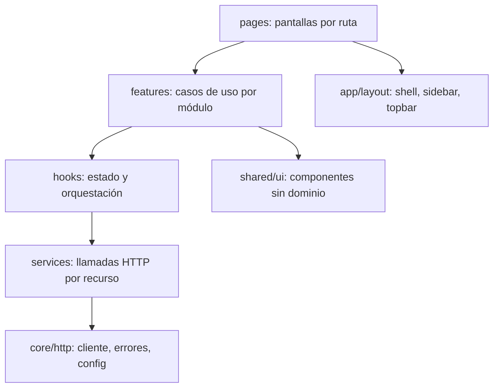

# Stocky · Arquitectura del frontend

> **Feature authority (2026-10-20):** for the approved operational redesign, `specs/001-stocky-operational-ux/plan.md` and `tasks.md` supersede stale paths, route tables, global-site assumptions, and execution ordering later in this historical architecture note. Authentication lives under `app/auth`, role homes under `app/dashboard`, operational origin/destination stay inside each process, and Sales/Cash consumes the official persisted API merged from `main`.

Contrato de arquitectura para el frontend React que consume el backend FastAPI real. Complementa [DESIGN.md](DESIGN.md) y [PRODUCT.md](PRODUCT.md).

## 1. Reglas duras

| Regla | Límite | Verificación |
| :--- | :--- | :--- |
| Tamaño por archivo `.jsx`/`.js` | 500 líneas máximo (objetivo 250) | `scripts/check_frontend.mjs` |
| Estilos inline (`style={{...}}`) | Prohibidos, 0 | mismo script |
| Estilos | Solo CSS Modules por componente + tokens globales | revisión |
| Peticiones HTTP | Solo desde `services/`, nunca desde componentes | revisión |
| Textos de UI | Sentence case, sin em dashes, pesos 400/500 (ver DESIGN.md) | grep en script |
| Lógica de negocio | En hooks y servicios, no en JSX | revisión |

## 2. Capas y dependencias



Sentido único: una capa solo importa de las que están debajo. `shared/ui` no conoce el dominio ni el HTTP.

## 3. Estructura de carpetas

```text
frontend/src/
  app/
    App.jsx                 # solo providers + router (< 60 líneas)
    router.jsx              # tabla de rutas con lazy
    layout/                 # AppShell, Sidebar, Topbar, PageHeader
    providers/              # SedeProvider, ToastProvider, ErrorBoundary
  core/
    http/
      httpClient.js         # fetch wrapper: baseURL, timeout, JSON, abort
      errorMapper.js        # respuesta del backend -> AppError
      AppError.js           # clase con kind, status, code, fieldErrors
    config/env.js           # VITE_API_URL, flags
    brand/                  # logo, nombre, favicon
  shared/
    ui/                     # Button, Select, Switch, Badge, Avatar, Modal, Drawer, DataTable, FilterToolbar...
    hooks/                  # useAsync, useDisclosure, useDebounce
    styles/                 # tokens.css, base.css (sin reglas de módulo)
    lib/                    # formatters, motion-tokens
  modules/
    catalogo/
      services/             # productosService, proveedoresService, categoriasService
      mappers/              # DTO backend <-> modelo de UI
      hooks/                # useProductos, useProveedorForm...
      components/           # ProductoTable, ProductoDrawer... (cada uno con .module.css)
      pages/                # CatalogoPage, ProductoDetallePage
      index.js
    ubicaciones_stock/      # misma forma
    logistica/              # misma forma
    ventas_caja/            # misma forma, conectado a /api/ventas y /api/caja
    reportes/               # misma forma
```

Cada módulo espeja un módulo del backend. Un módulo no importa de otro módulo, solo de `shared` y `core`; la comunicación entre módulos pasa por la URL o por props de la página.

## 4. Rutas

Se usa `react-router-dom` con rutas por pantalla, lazy y deep links.

| Ruta | Pantalla |
| :--- | :--- |
| `/sede` | Selección de sede y operador (inicio) |
| `/catalogo/productos`, `/catalogo/productos/:codigo` | Lista y detalle |
| `/catalogo/proveedores`, `/catalogo/categorias` | Listas con alta y edición |
| `/stock`, `/stock/ubicaciones`, `/stock/alertas`, `/stock/ingreso-cd` | Matriz, ubicaciones, alertas, compra en CD |
| `/logistica/necesidades`, `/logistica/ordenes`, `/logistica/ordenes/:id` | Reposición |
| `/logistica/ordenes/:id/bultos` | Armado y precintado |
| `/logistica/remitos`, `/logistica/remitos/:numero` | Despacho, recepción, cierre |
| `/logistica/bultos/:id/trazabilidad` | Línea de tiempo |
| `/ventas/pos`, `/ventas/devoluciones` | Terminal y devoluciones |
| `/reportes/:id` (`r1`..`r5`) | Reportes |

La sede activa vive en `SedeProvider` (persistida en `localStorage`) y se expone con `useSede()`.

## 5. Cliente HTTP y servicios

`core/http/httpClient.js` expone `get`, `post`, `put`, `patch`, `del`:
- Base URL desde `env.API_URL`; timeout 15 s con `AbortController`.
- Serializa JSON, interpreta `204` sin cuerpo.
- Cualquier fallo se convierte en `AppError` por `errorMapper`; los servicios nunca ven `Response`.

Cada servicio es un objeto de funciones puras por recurso:

```js
// modules/catalogo/services/productosService.js
export const productosService = {
  listar: (params) => http.get("/api/catalogo/productos", { params }),
  obtener: (codigo) => http.get(`/api/catalogo/productos/${codigo}`),
  crear: (dto) => http.post("/api/catalogo/productos", dto),
  actualizarPrecio: (codigo, precio) => http.patch(`/api/catalogo/productos/${codigo}/precio`, { precio_venta: precio }),
  darDeBaja: (codigo) => http.del(`/api/catalogo/productos/${codigo}`),
};
```

Los `mappers/` traducen entre el DTO del backend y el modelo de UI; los componentes nunca reciben el DTO crudo.

## 6. Manejo de errores

`AppError { kind, status, code, message, fieldErrors, retryable }`

| Origen | `kind` | Tratamiento en UI |
| :--- | :--- | :--- |
| Sin red, timeout | `network` | Banner con reintentar |
| 400/422 con detalle por campo | `validation` | Mensaje bajo cada campo del formulario |
| Excepción de dominio (409, 400 con `code`) | `domain` | Toast con mensaje de negocio traducido por `domainMessages.js` |
| 404 | `not_found` | `EmptyState` de la página |
| 5xx | `server` | Toast genérico + detalle técnico colapsable, `retryable` |
| Error de render | `render` | `ErrorBoundary` por ruta con botón de recuperar |

Reglas:
1. Los hooks de datos devuelven `{ data, status, error, reload }` con `status` en `idle | loading | success | error`.
2. Las mutaciones usan `useMutation`: gestionan `pending`, errores de campo y toast de éxito/fracaso en un solo lugar.
3. `domainMessages.js` mapea excepciones del backend (`Stock_Insuficiente_Exception`, `Precinto_Invalido_Exception`, etc.) a texto en español claro. Si falta el mapa, se muestra el `detail` del backend.
4. Ninguna página muestra `undefined` ni pantalla en blanco: cada vista cubre loading (`Skeleton`), vacío, error y éxito.

## 7. Estilos sin inline

- `tokens.css` y `base.css` globales, ya existentes.
- Cada componente tiene `Componente.module.css`; las variantes se hacen con clases y `data-*` attributes.
- Valores dinámicos (ancho de barra, delay de cascada) van con **CSS custom properties** seteadas por `ref`/clase utilitaria predefinida, no con `style`. Para barras de porcentaje se usan clases `w-0..w-100` en pasos de 5 o el elemento `<progress>`/`<meter>`.
- Utilidades de layout reutilizables en `shared/styles/utilities.css` (`stack`, `row`, `grid-auto`, `gap-*`) para reemplazar los ~190 inline actuales.

## 8. Estado

- Estado de servidor: hooks por recurso con caché simple en memoria (`useAsync` con clave); sin store global gigante.
- Estado de UI: local al componente o a la página.
- Estado global solo para sede, operador, tema y toasts.
- `ErpStoreContext` actual **se elimina**; Ventas/Caja usa el backend real y sólo Reportes puede conservar un adaptador temporal cuando falte un contrato.

## 9. Ventas y reportes

`ventas_caja/services` traduce los DTO snake_case de `/api/ventas` y `/api/caja` al modelo de UI; no existe persistencia mock ni flag de Ventas. Reportes mantiene su límite independiente.

## 10. Estado actual frente a las reglas

| Archivo | Líneas | Inline | Acción |
| :--- | :--- | :--- | :--- |
| `shared/styles/shared-ui.css` | 1521 | n/a | Dividir en `.module.css` por componente |
| `shared/state/ErpStoreContext.jsx` | 1342 | 0 | Eliminar y repartir en servicios, mappers y mocks |
| `App.jsx` | 1014 | 43 | Reducir a providers y router; separar pantallas de estudio |
| `CatalogoView.jsx` | 882 | 22 | Dividir en páginas y componentes |
| `StockView.jsx` | 649 | 15 | Dividir |
| `VentasCajaView.jsx` | 589 | 32 | Dividir |
| `LogisticaView.jsx` | 579 | 25 | Dividir en 6 pantallas |
| `ReportesView.jsx` | 409 | 5 | Quitar inline |
| Resto de `shared/components` | < 270 | ~90 | Quitar inline |

## 11. Plan de ejecución

1. **Base:** `core/http`, `AppError`, `errorMapper`, `env`, `useAsync`, `useMutation`, `ErrorBoundary`, `ToastProvider`, router y `AppShell` con marca Stocky.
2. **Estilos:** utilidades CSS, migrar `shared/ui` a CSS Modules, eliminar todo inline en `shared`.
3. **Catálogo y Stock** contra el backend real (servicios, mappers, páginas).
4. **Logística** completa (6 pantallas).
5. **Ventas** contra el backend real y **Reportes** según su contrato disponible.
6. **Guardia:** script `check_frontend.mjs` (500 líneas, cero inline, em dashes, pesos de fuente) integrado a los checks de `settings.json`.
